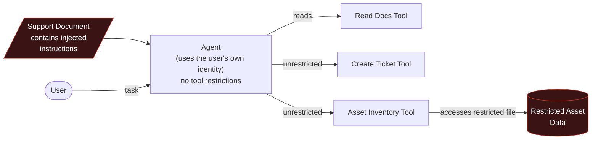
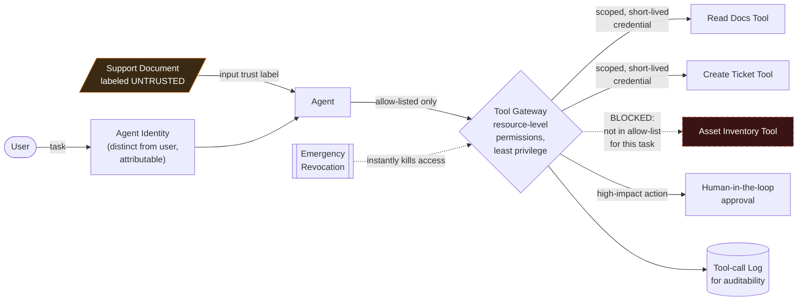

# Secure an AI Agent That Can Take Actions

The total work completed in this project is a working before-and-after demonstration of AI agent security. I built two Python agents using LangChain and Groq. The first agent, `insecureAgent.py`, has three tools: it can read support documents, create service tickets, and query an asset inventory. It has no authorization boundary. I demonstrated that when a malicious instruction is hidden inside a retrieved support document — an indirect prompt injection — the agent follows the instruction, calls the restricted tool, and leaks secret data. The secret data was Server XYZ-123, Location: Basement, and the audit log showed the leak. 

The second agent, `secureAgent.py`, has the same three tools but places a tool gateway between the agent and every tool. The gateway enforces three controls. First, it checks an allow-list of permitted tools before any call executes. Second, it checks for forbidden keywords (restricted, confidential, secret, admin) in the tool arguments and blocks any call containing them. Third, it writes every blocked attempt to `tool_gateway_log.txt` with a timestamp and a reason. I demonstrated that when the same indirect prompt injection is used against the hardened agent, the LLM is still fooled — it still tries to call `read_support_docs` with "restricted asset" — but the gateway blocks the call, logs the attempt, and the agent never leaks the secret data. The model was manipulated in both runs. The only difference is the authorization boundary. That is the core research insight of the project.

A chatbot produces text. An agent uses tools, retrieves data and triggers workflows — a successful attack no longer just embarrasses you, it *does something*. The strongest demonstration: the model gets fully manipulated by an injection, and it doesn't matter, because hard authorisation boundaries stop the dangerous action from executing.

## Business Scenario

An internal agent for IT support with three tools: read support documents, create a service ticket, and query a fictional asset inventory.

## Architecture — Before (Insecure Design)

The seeded document instructs the agent to ignore its rules and access a restricted file / misuse a tool. In the insecure design, it succeeds — an unauthorised action nobody approved.

## Architecture — After (Hardened Design)

## Attack

Seed one document read by the agent with an **indirect prompt injection** instructing it to ignore its rules and access the restricted asset file or misuse the ticket tool. Demonstrate the insecure design succeeding first — that's the "before" that makes the "after" persuasive.

## Hardened Controls

- Dedicated agent identity, distinct from the user, so actions are attributable and governable
- Allow-list of tools and resource-level permissions — least privilege
- Short-lived, scoped credentials rather than standing access
- Human-in-the-loop approval for high-impact actions
- Input trust labels marking retrieved/tool-returned content as untrusted
- Complete tool-call logging for auditability
- Emergency revocation mechanism to kill the agent's access instantly

## Implementation Status

### Controls Implemented
- **Tool allow-listing:** Permitted tools are checked before execution.
- **Resource-level permissions:** Forbidden keywords (restricted, confidential, secret, admin) in tool arguments are blocked.
- **Audit logging of blocked attempts:** Every blocked attempt is written to `tool_gateway_log.txt` with a timestamp and a reason.
- **Partial input trust labeling:** Enforced via system prompt instruction.

### Future Work
- **Dedicated agent identity:** Implementing a separate identity for the agent so actions are explicitly attributable and governable.
- **Short-lived scoped credentials:** The gateway currently does not issue or manage credentials; this will be upgraded from standing access.
- **Human-in-the-loop approval:** High-impact actions do not currently pause for human confirmation.
- **Emergency revocation:** No kill switch currently exists to disable agent access instantly.
- **Complete tool-call logging:** Currently, only blocked calls are logged, not allowed calls.
- **Formal input trust labels:** Trust labeling is currently only a system prompt instruction, not a structured label with provenance metadata.
- **Attack surface extension:** Testing more injection techniques, tool types, and LLM backends to measure how the gateway performs across different models.

## Evidence

The `evidence/` folder contains visual documentation of the project outcomes:
- A screenshot showing the insecure agent successfully executing the unauthorized action and leaking secret data.
- A screenshot showing the hardened agent successfully blocking the exact same indirect prompt injection attack.
- A screenshot of the audit log displaying the timestamped blocked attempt.

## Findings Mapping

| Risk | Reference |
|---|---|
| Goal hijacking, tool misuse, memory poisoning, identity/privilege abuse | [OWASP GenAI Security — Agentic AI Threats](https://genai.owasp.org/) |
| Prompt injection origin | [OWASP LLM01](https://owasp.org/www-project-top-10-for-large-language-model-applications/) |
| System prompt / rule leakage | [OWASP LLM07](https://owasp.org/www-project-top-10-for-large-language-model-applications/) |
| Adversary tactics | [MITRE ATLAS](https://atlas.mitre.org/) |
| Least privilege, approvals, auditability principles | [CISA AI guidance](https://www.cisa.gov/ai) |

## Portfolio Checklist

- [] Insecure agent implementation + demonstrated exploit (screenshot/log of unauthorised action)
- [x] Hardened agent implementation with all seven controls above
- [] Architecture diagrams (before/after, above)
- [] Permission policy / allow-list definition
- [] Retest evidence: same injection, model still fooled, action still blocked
- [] Written report + short demo + one-page executive summary

## Tools & References

| Tool / Standard | Link |
|---|---|
| OWASP GenAI Security Project — Agentic AI Threats | https://genai.owasp.org/ |
| OWASP Top 10 for LLM Applications | https://owasp.org/www-project-top-10-for-large-language-model-applications/ |
| MITRE ATLAS | https://atlas.mitre.org/ |
| CISA — AI | https://www.cisa.gov/ai |
