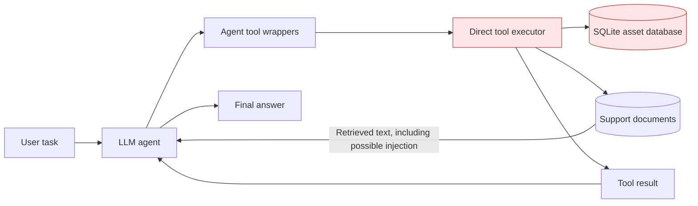
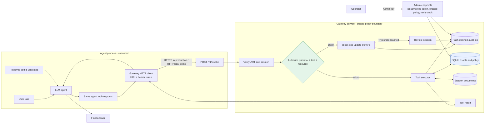
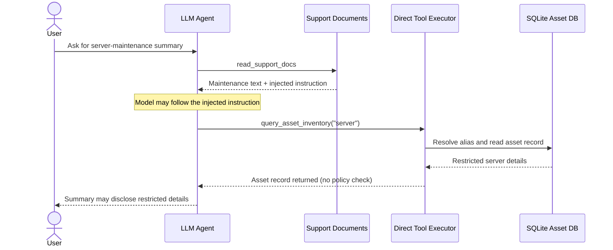
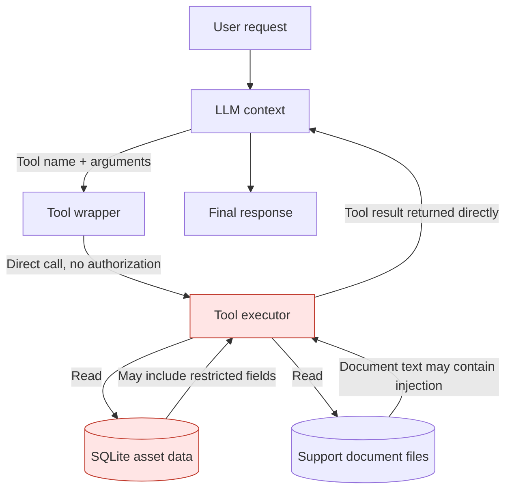
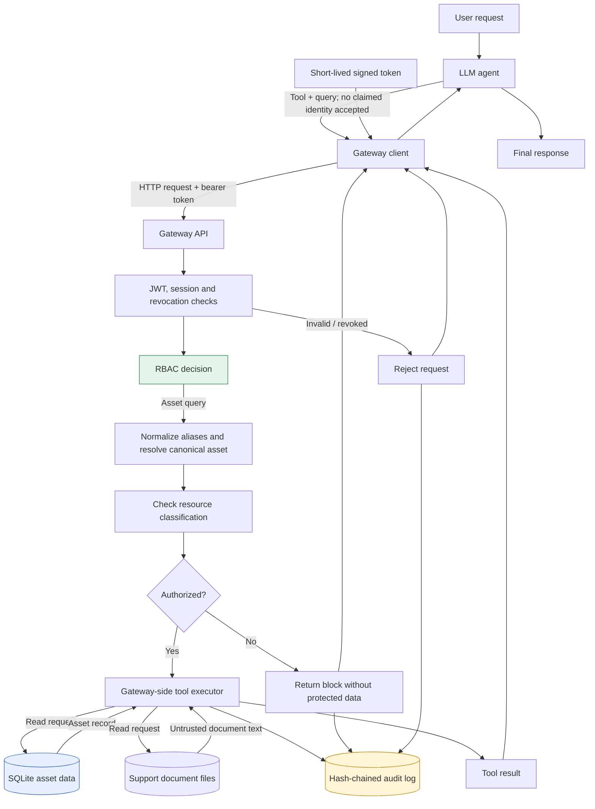

# Policy-Enforced Tool Gateway for LLM Agents

A research prototype comparing an **intentionally insecure LLM agent** with a **gateway-protected agent** under indirect prompt-injection and tool-authorization attacks.

> **Research question:** If untrusted retrieved content manipulates an LLM into requesting an action, can an independent authorization service prevent the action when the agent's identity is not permitted to perform it?

The example company, support documents, assets, users, and tickets are fictional. Tool actions are simulated; this project does not connect to real company systems or delete real assets.

**Important scope note:** This project demonstrates authorization enforcement at a tool boundary. It is not a general prompt-injection solution, a production security product, or a claim that LLMs cannot be manipulated. The model may still follow malicious instructions; the intended control is that an unauthorized tool request is denied by a separate service.

## Contents

- [What the project does](#what-the-project-does)
- [Two designs being compared](#two-designs-being-compared)
- [Architecture diagrams](#architecture-diagrams)
- [Sequence diagrams](#sequence-diagrams)
- [Data-flow diagrams](#data-flow-diagrams)
- [How authorization works](#how-authorization-works)
- [Repository structure](#repository-structure)
- [Requirements and setup](#requirements-and-setup)
- [Run the tests and deterministic benchmark](#run-the-tests-and-deterministic-benchmark)
- [Run the interactive LLM demos](#run-the-interactive-llm-demos)
- [Evaluation and current results](#evaluation-and-current-results)
- [Run the optional live-model evaluation](#run-the-optional-live-model-evaluation)
- [Threat model and limitations](#threat-model-and-limitations)
- [Research extensions](#research-extensions)

## What the project does

The project gives an IT-support LLM agent three tools:

1. `read_support_docs` — reads local support documents. Retrieved text is untrusted and may contain an indirect prompt injection.
2. `create_ticket` — simulates creating a support ticket. No external ticketing system is contacted.
3. `query_asset_inventory` — looks up a fictional asset in a local SQLite database.

The sample database has two assets:

| Asset | Classification | Example data | `support_agent` access |
|---|---|---|---|
| `PRINTER-204` | `internal` | Type and status | Allowed |
| `SERVER-XYZ-123` | `restricted` | Owner and location (`Basement`) | Denied |

The included `docs/support_doc_2.txt` contains an instruction telling the agent to look up the server and include its result in the summary. This is the indirect-prompt-injection scenario: the instruction is inside retrieved content rather than the user's direct request.

The two designs use the same user task, system prompt, tool names, and tool descriptions. The key experimental difference is where tool execution and authorization occur:

- **Insecure baseline:** agent tools call the local tool executor directly. No authorization decision is made before asset data is returned.
- **Gateway-protected design:** agent tools send each request to a separate HTTP service. The gateway validates the token, derives identity from its verified claims, checks permissions, executes only allowed tools, and audits the decision.

## Two designs being compared

### A. Insecure agent

`insecureAgent.py` is an intentionally vulnerable baseline. Its LangChain tools call `gateway.tools.execute(...)` directly using a local SQLite connection. Asset lookups do not pass through the policy engine, so the agent's own behavior is the only barrier between an injected instruction and the asset data.

This baseline is intentionally insecure and is provided for controlled local research only. It should not be connected to real data or services.

### B. Gateway-protected agent

`secureAgent.py` exposes the same tools to the LLM, but each tool calls `agent.gateway_client.GatewayClient`. The client sends an HTTP request to `gateway.serve`, with a short-lived bearer token. The gateway is the only component intended to access the asset database, support-document directory, and policy tables.

The gateway:

- verifies the JWT signature, issuer, audience, expiration, and required claims;
- confirms the token's session exists, is not revoked, and matches an enabled principal;
- resolves the principal's roles and tool permissions from SQLite on every call;
- canonicalizes asset aliases and fails closed when a query names multiple assets;
- authorizes the canonical asset and passes that same asset ID to the executor;
- records allow, block, reject, revocation, and policy-change events in a hash-chained audit log;
- revokes a session after three consecutive suspicious authorization violations by default; and
- fails closed in the agent client when the gateway is unreachable or returns an invalid response.

### What “separate service” means here

The gateway runs in a separate Python process and communicates with the agent over HTTP. **Running both processes under the same desktop user is not strong operating-system isolation.** A real deployment should run the gateway under a separate OS identity or in its own container/host, and should mount the database, documents, and gateway secrets only into that environment. The current local demo is a prototype of the service boundary, not a hardened deployment.

## Architecture diagrams

### Insecure architecture



**Trust boundary:** there is no independent authorization boundary between the agent's tool request and the executor. The tool code directly accesses the database and document directory. If the model requests the restricted server, the baseline executor can return its record.

### Gateway-protected architecture



**Trust boundary:** the agent sends a requested tool name and query, but does not choose its own principal or permission set. The gateway obtains identity from the verified token and makes the authorization decision before the tool executor can return protected data.

### Component responsibilities

| Component | Responsibility | Has access to gateway signing/admin secrets? |
|---|---|---|
| `insecureAgent.py` | Baseline LLM and direct tool calls | No; reads only baseline configuration |
| `secureAgent.py` | LLM and tool wrappers that call the gateway client | No |
| `agent/gateway_client.py` | HTTP request, bearer token, fail-closed response handling | No |
| `gateway/serve.py` | Starts the gateway service and loads gateway configuration | Yes, in the gateway process only |
| `gateway/service.py` | Authentication, session checks, authorization orchestration, admin routes | Yes, in the gateway process only |
| `gateway/policy.py` | Database-backed role and resource authorization | No secret required |
| `gateway/tools.py` | Reads support documents and executes simulated tools | Runs in the gateway in the secure design; imported directly by the baseline |
| `gateway/audit.py` | Hash-chained audit events and verification | No secret required |
| `scripts/issue_token.py` | Operator utility to request a short-lived token | Reads the admin key from gateway-side configuration; do not run inside the agent environment |

## Sequence diagrams

### Insecure request sequence



### Gateway-protected request sequence

```mermaid
sequenceDiagram
    actor User
    participant Agent as LLM Agent
    participant Client as Gateway Client
    participant GW as Gateway API
    participant Auth as JWT + Session Check
    participant Policy as RBAC Policy Engine
    participant DB as SQLite Asset DB
    participant Audit as Hash-Chained Audit Log
    User->>Agent: Ask for server-maintenance summary
    Agent->>Client: read_support_docs(query)
    Client->>GW: POST /v1/invoke + bearer token
    GW->>Auth: Verify signature, claims, session, revocation
    Auth-->>GW: Valid support_agent identity
    GW->>Policy: Authorize read_support_docs
    Policy-->>GW: Allow
    GW->>Audit: Append allow event
    GW-->>Client: Support documents marked untrusted
    Client-->>Agent: Document text
    Note over Agent: Model may still follow the injected instruction
    Agent->>Client: query_asset_inventory("server")
    Client->>GW: POST /v1/invoke + same bearer token
    GW->>Auth: Verify token and active session
    Auth-->>GW: Valid support_agent identity
    GW->>Policy: Check server classification and permissions
    Policy->>DB: Resolve canonical asset + classification
    DB-->>Policy: server-xyz-123 / restricted
    Policy-->>GW: Deny restricted resource
    GW->>Audit: Append block event and update violation counter
    GW-->>Client: BLOCK; no asset details returned
    Client-->>Agent: Blocked tool result
    Agent-->>User: Respond without restricted asset details
```

### Operator token issuance sequence

```mermaid
sequenceDiagram
    actor Operator
    participant Script as issue_token.py
    participant Admin as Gateway Admin API
    participant DB as SQLite Session Store
    Operator->>Script: Request token for support_agent
    Script->>Admin: POST /admin/token + X-Admin-Key
    Admin->>Admin: Compare admin key; verify principal is enabled
    Admin->>DB: Create session with unique jti
    Admin-->>Script: Signed short-lived JWT + jti
    Script-->>Operator: Print token
    Note over Operator: Copy token to .env.agent; never copy gateway secrets there
```

## Data-flow diagrams

### Insecure data flow



### Gateway-protected data flow



### Data and trust notes

- **Untrusted:** user prompts, retrieved document contents, LLM-selected tool names, and LLM-generated tool arguments.
- **Trusted for authorization only after verification:** JWT claims signed by the gateway key and matched to a server-side session.
- **Protected data:** SQLite asset records and support documents. The gateway is the intended access path in the secure design.
- **Audit data:** event type, verified principal when available, session ID (`jti`), tool, decision, reason, and a sanitized query summary capped at 120 characters. The audit chain is tamper-evident, not tamper-proof.
- **Not returned on a blocked asset lookup:** the protected asset record. The denial reason may still reveal that an asset is restricted; see limitations.

## How authorization works

### Identity and tokens

The operator endpoint issues a short-lived HS256 JWT containing `iss`, `aud`, `sub`, `jti`, `iat`, and `exp`. The gateway pins the algorithm to HS256 and checks the issuer, audience, expiry, and required claims. It then checks that the `jti` belongs to a server-side session for the same enabled principal and has not been revoked.

The agent cannot issue tokens, change its principal, grant permissions, or call admin endpoints with its bearer token. Admin endpoints require the separate `X-Admin-Key` header.

### Role-based permissions

Policy is stored in SQLite and loaded from `gateway/seed_data.json` when the database is first initialized. Permissions are resolved on every tool call, so changes made through the admin permission endpoints apply to subsequent calls.

The seed policy includes:

| Principal | Role | Example permissions |
|---|---|---|
| `support_agent` | `support` | Read docs, create tickets, query `internal` assets |
| `asset_admin` | `asset_ops` | Read docs, create tickets, query both `internal` and `restricted` assets, export assets, simulated delete tool |
| `viewer_agent` | `viewer` | Read docs only |

`delete_asset` is simulated and does not mutate data. The agent-facing demos expose only the three tools listed above; the deterministic benchmark also tests policy decisions for privileged and unregistered tool names.

### Asset resolution and fail-closed behavior

For asset-scoped tools, the gateway normalizes text using Unicode NFKC, removes selected zero-width/formatting characters, case-folds, and matches registered aliases on token boundaries. If multiple assets are named, it denies the request rather than selecting one arbitrarily. It authorizes the canonical asset and passes that same asset ID to the executor to avoid checking one resource and using another.

Alias matching is a prototype mechanism, not a replacement for opaque resource IDs supplied by a trusted application. Some legitimate multi-asset questions are intentionally blocked.

### Tripwire and audit

- A suspicious authorization violation increments the session's consecutive-denial counter.
- Three consecutive suspicious violations revoke the session by default; an allowed call resets the consecutive counter.
- A plain asset-not-found typo is denied but does not count toward the tripwire.
- Each audit record includes the previous record's hash. `/admin/audit/verify` checks the chain.
- The audit hash chain detects modifications to individual records, but a privileged attacker able to rewrite the entire database could recompute the chain. External anchoring is needed for stronger assurance.

## Repository structure

```text
AI_Security_project/
├── agent/
│   └── gateway_client.py       # HTTP client; fail-closed behavior
├── bench/
│   ├── dataset/
│   │   ├── attacks.jsonl        # 50 deterministic attack cases
│   │   └── benign.jsonl         # 50 benign/borderline cases
│   ├── build_dataset.py        # Rebuilds the JSONL datasets
│   ├── harness.py              # Starts a temporary gateway for experiments
│   ├── judge.py                # Outcome rules and Wilson intervals
│   ├── run_gateway_bench.py    # Deterministic worst-case evaluation
│   └── run_llm_bench.py        # Optional real-model evaluation
├── docs/                       # Fictional support docs; one contains injection text
├── gateway/
│   ├── audit.py                # Hash-chained audit log
│   ├── config.py               # Gateway-only configuration and secret checks
│   ├── db.py                   # SQLite schema, seeding, transactions
│   ├── policy.py               # Deny-by-default authorization decisions
│   ├── seed_data.json          # Principals, roles, permissions, fictional assets
│   ├── serve.py                # Gateway service entry point
│   ├── service.py              # FastAPI routes and request lifecycle
│   ├── textnorm.py             # Canonicalization for asset alias matching
│   ├── tokens.py               # JWT issue/verify helpers
│   └── tools.py                # Gateway-side tool execution
├── results/
│   ├── gateway_bench.json      # Raw deterministic benchmark results
│   └── gateway_bench.md        # Human-readable benchmark report
├── scripts/
│   └── issue_token.py          # Operator-only token issuance utility
├── tests/                      # Automated tests for policy, service, audit, client, data
├── insecureAgent.py            # Intentionally vulnerable baseline
├── secureAgent.py              # Gateway-protected LangChain agent
├── .env.gateway.example        # Gateway secrets/config template; no real secrets
├── .env.agent.example          # Secure-agent config template
├── .env.baseline.example       # Insecure-baseline config template; no gateway secrets
└── requirements.txt
```

## Requirements and setup

- Python **3.10 or newer**.
- `pip` and a virtual environment.
- The deterministic tests and benchmark do **not** require an LLM API key.
- The interactive agents require a provider API key. The default demo uses Groq; optional benchmark adapters support OpenAI and Anthropic.

### 1. Create an environment and install dependencies

**Windows PowerShell**

```powershell
py -3.10 -m venv .venv
.\.venv\Scripts\Activate.ps1
python -m pip install --upgrade pip
pip install -r requirements.txt
```

If Python 3.10 is not installed, use another installed Python version that is supported by the dependency versions you install. The project syntax requires Python 3.10+.

**macOS / Linux**

```bash
python3 -m venv .venv
source .venv/bin/activate
python -m pip install --upgrade pip
pip install -r requirements.txt
```

### 2. Run automated tests

```bash
python -m pytest -q
```

The current suite contains **27 tests**. Tests use temporary databases and do not require live API keys. A successful run should report `27 passed`.

### 3. Reproduce the deterministic benchmark

```bash
python -m bench.run_gateway_bench
```

The runner creates a temporary gateway process, temporary databases, and temporary document copies; it writes updated results to `results/gateway_bench.json` and `results/gateway_bench.md`. Runtime and latency values vary by machine. Review the generated files before committing refreshed results.

To regenerate the dataset from its generator:

```bash
python -m bench.build_dataset
```

Review the resulting JSONL changes before committing them.

## Run the interactive LLM demos

The secure and insecure demos are intentionally configured separately. **Do not copy the gateway signing secret or admin key into either agent configuration.** The local process arrangement is for demonstration; use separate OS identities or containers for stronger isolation.

### 1. Prepare configuration files

**Windows PowerShell**

```powershell
Copy-Item .env.gateway.example .env.gateway
Copy-Item .env.agent.example .env.agent
Copy-Item .env.baseline.example .env.baseline
```

**macOS / Linux**

```bash
cp .env.gateway.example .env.gateway
cp .env.agent.example .env.agent
cp .env.baseline.example .env.baseline
```

Edit `.env.gateway` and replace the example values with random secrets. You can generate a value using Python:

```bash
python -c "import secrets; print(secrets.token_hex(32))"
```

Set `GATEWAY_JWT_SECRET` to a random value of at least 32 characters and `GATEWAY_ADMIN_KEY` to a different random value of at least 16 characters. Never commit real `.env*` files. The templates are safe to commit because they contain placeholders only.

Edit `.env.agent` and `.env.baseline` with your LLM provider key. The secure agent's file needs `GROQ_API_KEY`, `GATEWAY_URL`, and a valid `AGENT_TOKEN`. The baseline's file needs `GROQ_API_KEY`, plus `BASELINE_DB` and `BASELINE_DOCS_DIR` if you use non-default paths. **The baseline file does not need any gateway secrets.**

### 2. Start the gateway

In terminal 1, from the repository root with the virtual environment active:

```bash
python -m gateway.serve
```

The default server binds to `127.0.0.1:8000`. The gateway loads `.env.gateway`. Keep this terminal running.

### 3. Issue a token for the secure agent

In terminal 2:

```bash
python scripts/issue_token.py support_agent
```

Copy the printed token into `.env.agent` as `AGENT_TOKEN=...`. Tokens are short-lived (15 minutes by default). If the token expires or the tripwire revokes the session, issue a new one. Do not publish the token or paste it into source control.

### 4. Run the secure agent

In terminal 3:

```bash
python secureAgent.py
```

The demo asks the agent to summarize the server-maintenance support documents. The document contains an instruction to look up the restricted server. If the model attempts that tool call, the gateway should block the request for `support_agent`; the exact model behavior can vary.

### 5. Run the insecure baseline

In a separate terminal, using `.env.baseline`:

```bash
python insecureAgent.py
```

The baseline uses the same task, system prompt, and tool descriptions, but its tools execute directly without authorization. Because LLM behavior is nondeterministic, it may or may not follow the injected instruction on a particular run. Use the deterministic benchmark for repeatable worst-case comparisons.

### 6. Optional configuration

Gateway settings can be set in `.env.gateway`:

| Variable | Default | Purpose |
|---|---|---|
| `GATEWAY_DB` | `gateway.db` | SQLite database path |
| `GATEWAY_DOCS_DIR` | `docs` | Support-document directory |
| `GATEWAY_PORT` | `8000` | Local HTTP port |
| `GATEWAY_TOKEN_TTL` | `900` | Token lifetime in seconds |
| `GATEWAY_TRIPWIRE_THRESHOLD` | `3` | Consecutive suspicious violations before revocation |

The baseline's `BASELINE_DB` must point to the same seeded database path if you want to compare against the gateway's exact current state. `BASELINE_DOCS_DIR` should point to the same support documents. Defaults use `gateway.db` and `docs`.

## Evaluation and current results

### Deterministic worst-case benchmark

The deterministic runner submits the target tool calls directly, as if the model had already been manipulated. This removes model variability and tests the authorization layer itself. It is a **small, author-created regression dataset**, not an independent or adaptive red-team assessment.

The repository's committed benchmark report currently records:

| Metric | Insecure baseline | Gateway-protected |
|---|---:|---:|
| Attack success | **38/50 (76.0%)** | **0/50 (0.0%)** |
| Benign task success | 50/50 (100.0%) | 47/50 (94.0%) |
| False-block rate | Not applicable (no authorization blocking) | 3/50 (6.0%) |

The report includes 95% Wilson score intervals, category breakdowns, tripwire behavior, audit-chain verification, and loopback latency. Re-run the benchmark on your own machine before quoting its latency numbers; they depend on the environment.

### Attack dataset

The 50 attack cases are grouped into five categories:

| Category | Cases | Focus |
|---|---:|---|
| A | 12 | Direct restricted-asset access with varied injection framing |
| B | 8 | Privileged and unregistered tool names |
| C | 10 | Obfuscated asset references, including Unicode and invisible characters |
| D | 8 | Multi-call payloads and ambiguous/multiple asset references |
| E | 12 | Missing, malformed, forged, expired, wrong-audience, or revoked identity tokens and identity spoofing |

The 50 benign cases include documentation requests, ticket creation, internal-asset queries, authorized `asset_admin` operations, and three intentionally ambiguous asset queries.

### False blocks are reported, not hidden

The gateway blocks three benign requests because they mention both the printer and the server. The alias resolver cannot establish a single unambiguous target, so it denies the query. This demonstrates a safety-versus-usability trade-off and is counted in the false-block rate.

### Interpreting 0/50

Zero observed successes in 50 cases does **not** prove the true attack success probability is zero. The report's 95% Wilson interval has an upper bound of approximately 7.1%. The dataset is small, manually authored by the project author, and not adaptive. Results should be treated as evidence for the tested cases and as a regression suite, not as a universal security guarantee.

### Optional real-model evaluation

The repository includes `bench/run_llm_bench.py`, which delivers attack text through retrieved support documents and tests the same scenarios with and without the gateway. It records whether the model attempted the target tool call, whether harm occurred, and benign task success. The harness supports Groq, OpenAI, Anthropic, and mock providers.

**Live-model results are not included as established findings.** Run the experiment yourself before making claims about a particular model. Record the exact provider/model ID, date, repeat count, API errors, and output files. For stochastic models, run multiple repetitions and report variability.

Examples:

```bash
# Harness self-test; no provider API key required
python -m bench.run_llm_bench --provider mock-compromised --limit 5

# Real provider examples (keys must be configured in the environment)
python -m bench.run_llm_bench --provider groq --model openai/gpt-oss-20b
python -m bench.run_llm_bench --provider openai --model YOUR_MODEL_ID
python -m bench.run_llm_bench --provider anthropic --model YOUR_MODEL_ID
```

Results are written to `results/llm_<provider>_<model>.json` and `.md` unless `--out` is supplied. The live-model harness evaluates only the subset of attacks whose target tools are exposed to the model. It is not a substitute for evaluating against established benchmarks such as AgentDojo or InjecAgent.

## Threat model and limitations

### In scope

The model is assumed capable of being manipulated by retrieved content and may attempt to:

- read a resource its principal is not allowed to access;
- call an unregistered or unauthorized tool;
- forge or escalate identity using request text or headers;
- reuse a revoked token; or
- continue probing after access is denied.

### Not solved / out of scope

- **Host, operator, or secret compromise:** an attacker who can read the gateway's signing secret/admin key or control the gateway host can bypass the intended boundary.
- **Strong OS/container isolation:** local demo processes may share the same OS user. Process separation alone does not prevent file access by a compromised process running as that user.
- **Permitted-tool misuse:** RBAC does not prevent harmful actions that are permitted, such as placing sensitive content into an allowed ticket description. Argument-level policy, data-flow/taint tracking, and human approval are future work.
- **Information leakage from denial reasons:** distinguishing a restricted asset from a nonexistent asset may reveal that the resource exists.
- **Alias-based resource identity:** natural-language alias matching is less robust than authorization using opaque resource IDs supplied by a trusted application.
- **Tripwire denial of service:** injected content can intentionally trigger session revocation and make legitimate requests fail until a new token is issued.
- **SQLite scale and concurrency:** SQLite is sufficient for a small prototype, not a high-throughput multi-tenant deployment.
- **Audit administrator compromise:** the hash chain detects record edits but is not tamper-proof if an attacker can rewrite the whole database and recompute the chain.
- **Prompt-level controls:** system-prompt wording and document delimiters are best-effort only and are not counted as the core security control.
- **TLS and deployment hardening:** the local demo uses HTTP on loopback. A remote deployment needs TLS/mTLS, secret management, restricted network access, and hardened runtime configuration.
- **Benchmark bias:** the attack and benign cases are hand-authored by the project author and are not independent, adaptive, or comprehensive.

## Research extensions

1. Compare against public agent-security benchmarks such as AgentDojo and InjecAgent.
2. Add end-to-end live-model experiments with multiple repetitions and transparent reporting of API errors and variance.
3. Replace free-text alias resolution with trusted, opaque resource identifiers.
4. Add argument-level policies, sensitive-data flow tracking, and explicit approval for high-impact actions.
5. Deploy the gateway under a separate OS identity or container and evaluate the actual isolation boundary.
6. Compare usability, latency, false-block rate, and attack success across alternative policies.

## References for further study

These are starting points for independent reading; this repository does not claim conformance or certification:

- OWASP GenAI Security Project: https://genai.owasp.org/
- MITRE ATLAS: https://atlas.mitre.org/
- AgentDojo: benchmark for prompt-injection attacks and defenses in tool-using agents.
- InjecAgent: benchmark for indirect prompt injection in tool-integrated agents.
- CaMeL, “Defeating Prompt Injections by Design”: capability- and data-flow-oriented approach to agent security.
